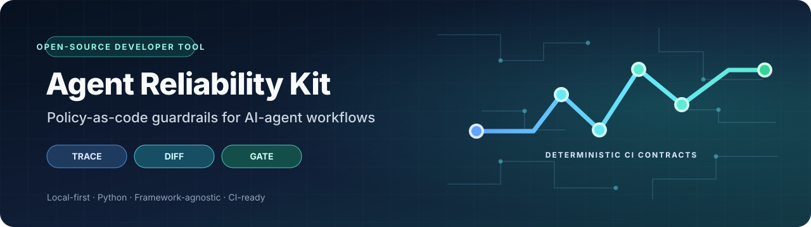
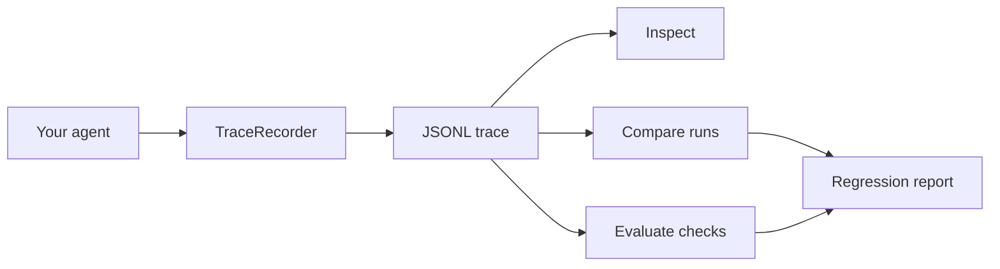

<div align="center">



# Agent Reliability Kit (ARK)

### Record. Inspect. Compare. Gate.

[](https://github.com/Hariharans1971/Agent-Reliability-Kit-ARK-/actions/workflows/tests.yml)
[](https://python.org)
[](LICENSE)
[](CONTRIBUTING.md)

**AI agents are easy to demo. They are harder to trust.**

A local-first Python toolkit for recording AI-agent workflows as readable JSONL traces and enforcing explicit CI contracts: allowed/required/forbidden actions, per-step execution budgets, and behavioral diffs.

</div>

---

## Why ARK?

Agent workflows can fail in subtle ways: a tool receives the wrong arguments, a result changes after a prompt update, or token usage grows unexpectedly. ARK gives developers a portable record and repeatable checks without requiring a hosted service or LLM API key.

| Capability | What it does |
|---|---|
| **Record** | Capture tool inputs/outputs, decisions, durations, and token counters |
| **Inspect** | Summarize a trace from the command line |
| **Diff** | Compare runs while ignoring timestamps and generated IDs |
| **Evaluate** | Run deterministic checks locally or in CI |
| **Gate** | Enforce JSON policy contracts for allowed/required/forbidden events, call limits, and total/per-step duration/token budgets |
| **Privacy-first** | Store JSONL locally; optional best-effort key redaction |
| **Framework-agnostic** | Instrument ordinary Python functions; keep integrations optional |

## Quick start

**Requirements:** Python 3.10+.

```bash
git clone https://github.com/Hariharans1971/Agent-Reliability-Kit-ARK-.git
cd Agent-Reliability-Kit-ARK-
python -m venv .venv

# Windows PowerShell
.\.venv\Scripts\Activate.ps1

# macOS / Linux
source .venv/bin/activate

python -m pip install -e .
python examples/customer_support_agent.py
ark inspect artifacts/customer-support.jsonl
ark evaluate artifacts/customer-support.jsonl --min-steps 3
ark diff examples/sample-trace.jsonl examples/sample-trace.jsonl
ark policy artifacts/customer-support.jsonl --policy policies/customer-support.json
```

To see the failure path, run this separately; it is expected to exit with code `1` because the sample trace contains event names outside the restrictive allowlist:

```bash
ark policy examples/sample-trace.jsonl --policy policies/reject-sample.json
```

## 60-second example

```python
from ark import TraceRecorder

trace = TraceRecorder("refund-agent", tags={"environment": "demo"})
trace.record(
    kind="tool",
    name="order_lookup",
    inputs={"order_id": "ORD-1042"},
    outputs={"status": "delivered", "amount": 49.99},
    duration_ms=18,
)
trace.record(
    kind="decision",
    name="refund_eligibility",
    inputs={"days_since_delivery": 3},
    outputs={"eligible": True},
)
trace.save("run.jsonl")
```

Each record becomes one line of JSONL. You can attach a trace to a bug report, diff runs in Git, or connect it to your own evaluation pipeline.

## How it works



ARK does not execute an LLM or transmit trace data by itself. A passing check means only that the configured checks passed; it is not a guarantee of agent correctness.

## Use ARK as a GitHub Action

ARK includes a composite action so a repository can fail CI when a recorded agent run violates a policy:

```yaml
- name: Generate or collect your agent trace
  run: python your_agent_test.py

- name: Enforce agent execution contract
  uses: Hariharans1971/Agent-Reliability-Kit-ARK-@main
  with:
    trace: artifacts/agent-trace.jsonl
    policy: policies/agent-policy.json
    python-version: "3.12"
```

Replace `@main` with a reviewed release tag or commit SHA for production workflows. The trace and policy paths are resolved from the consuming repository's workspace.

## CLI reference

| Command | Purpose |
|---|---|
| `ark inspect TRACE` | Summarize event count, types, duration, and token totals |
| `ark diff EXPECTED ACTUAL` | Report changed, added, or removed event positions |
| `ark diff EXPECTED ACTUAL --ignore-path inputs.request_id` | Ignore a selected dynamic field; repeat the flag for more paths |
| `ark evaluate TRACE` | Run baseline checks |
| `ark evaluate TRACE --min-steps 3` | Require at least three events |
| `ark evaluate TRACE --require order_lookup` | Require a named event |
| `ark evaluate TRACE --json` | Emit machine-readable baseline checks |
| `ark policy TRACE --policy POLICY.json` | Enforce event allowlists, required/forbidden events, and total/per-event metric budgets |
| `ark policy TRACE --policy POLICY.json --json` | Emit machine-readable policy results |

**Exit codes:** `0` checks passed, `1` regression/check failed, `2` invalid input or unreadable trace.

## Roadmap

- [x] JSONL trace recorder and reader
- [x] Inspect, diff, evaluate, and policy CLI
- [x] Declarative JSON policies for allowlisted/required/forbidden events, event/call limits, and total/per-step duration/token budgets
- [x] Reusable composite GitHub Action for policy enforcement
- [x] Best-effort recursive key redaction
- [x] Unit tests and GitHub Actions CI, including expected policy rejection
- [ ] Golden-trace fixture packs and comparison presets
- [x] Per-event duration and token budgets with missing-metric failure
- [ ] JUnit-compatible CI output
- [ ] Optional LangChain callback adapter
- [ ] Optional OpenAI-compatible API adapter
- [ ] Exportable HTML trace viewer

Roadmap items are proposals, not completed features. Please open an issue before starting a large contribution.

## Contributing

Bug reports, documentation improvements, synthetic examples, tests, and small integrations are welcome. Start with [CONTRIBUTING.md](CONTRIBUTING.md), check [the roadmap](docs/ROADMAP.md), or open an issue.

For a code change:

```bash
python -m unittest discover -s tests -v
```

### Good first contributions

- [Improve malformed trace validation (#3)](https://github.com/Hariharans1971/Agent-Reliability-Kit-ARK-/issues/3) — focused standard-library task.
- [Ignore selected JSON paths in diffs (#1)](https://github.com/Hariharans1971/Agent-Reliability-Kit-ARK-/issues/1) — make regression comparisons less noisy.
- [Validate ARK from a separate consumer repository (#5)](https://github.com/Hariharans1971/Agent-Reliability-Kit-ARK-/issues/5) — prove the action works outside its own repository.
- [Export JUnit XML (#4)](https://github.com/Hariharans1971/Agent-Reliability-Kit-ARK-/issues/4) — improve CI reporting.

Please comment on an issue before starting larger changes so we can agree on a small, reviewable scope.

## Security and privacy

Trace files may contain prompts, tool arguments, identifiers, or sensitive customer context. Never commit secrets or real production traces. The redaction helper is best-effort and does not guarantee anonymity. See [SECURITY.md](SECURITY.md).

## Documentation

- [Trace format](docs/TRACE_FORMAT.md)
- [Policy contracts](docs/POLICY_CONTRACTS.md)
- [Architecture and limitations](docs/ARCHITECTURE.md)
- [Why ARK? Project positioning and related tools](docs/WHY_ARK.md)
- [Roadmap](docs/ROADMAP.md)
- [Release checklist](docs/RELEASING.md)
- [Contribution guide](CONTRIBUTING.md)
- [Security policy](SECURITY.md)

## Project status

ARK is an early MVP built to invite practical feedback. Please report rough edges and limitations honestly. The best next feature is the one that solves a real user problem.

---

<div align="center">

**Found a bug? Open an issue. Want a feature? Start a discussion.**

Created by [Hariharan S.](https://github.com/Hariharans1971) · Released under the [MIT License](LICENSE)

</div>
