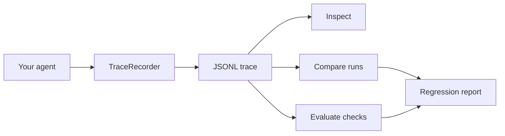

# Agent Reliability Kit (ARK)

**Record, inspect, compare, and regression-test AI-agent workflows — locally, with Python.**

Agent Reliability Kit is a small, framework-agnostic toolkit for recording AI-agent steps as readable JSONL traces and detecting behavioral changes between runs. It starts without a hosted service, API key, or mandatory third-party package.

> AI agents are easy to demo. They are harder to trust.

## Why ARK?

Agent workflows can fail in subtle ways: a tool receives the wrong arguments, a tool result changes after a prompt update, or token usage grows unexpectedly. ARK gives developers a portable trace and deterministic checks without claiming that any test can guarantee an agent is correct.

| Capability | What it does |
|---|---|
| Record | Capture tool inputs/outputs, decisions, durations, and token counters |
| Inspect | Summarize a trace from the command line |
| Diff | Compare two runs while ignoring timestamps and generated IDs |
| Evaluate | Run deterministic checks locally or in CI |
| Privacy-first | Keep JSONL traces local by default; optional best-effort key redaction |
| Framework-agnostic | Instrument ordinary Python functions; add integrations separately |

## Quick start

Requires Python 3.10+.

```bash
git clone https://github.com/Hariharans1971/Agent-Reliability-Kit-ARK-.git
cd Agent-Reliability-Kit-ARK-
python -m venv .venv
# Windows: .venv\Scripts\activate
# macOS/Linux: source .venv/bin/activate
python -m pip install -e .
python examples/customer_support_agent.py
ark inspect artifacts/customer-support.jsonl
ark evaluate artifacts/customer-support.jsonl --min-steps 3
ark diff examples/sample-trace.jsonl examples/sample-trace.jsonl
```

## 60-second example

```python
from ark import TraceRecorder

trace = TraceRecorder("refund-agent", tags={"environment": "demo"})
trace.record(
    kind="tool",
    name="order_lookup",
    inputs={"order_id": "ORD-1042"},
    outputs={"status": "delivered", "amount": 49.99},
    duration_ms=18,
)
trace.record(
    kind="decision",
    name="refund_eligibility",
    inputs={"days_since_delivery": 3},
    outputs={"eligible": True},
)
trace.save("run.jsonl")
```

A trace is plain JSONL — one event per line. Inspect it, diff it in Git, or use it in your own evaluation pipeline.

## Architecture



ARK does not execute an LLM or transmit trace data by itself. A passing check means only that the configured checks passed.

## CLI

| Command | Purpose |
|---|---|
| `ark inspect TRACE` | Summarize event count, kinds, duration, and token totals |
| `ark diff EXPECTED ACTUAL` | Report changed, added, or removed event positions |
| `ark evaluate TRACE` | Run deterministic baseline checks |
| `ark evaluate TRACE --min-steps 3` | Require at least three events |
| `ark evaluate TRACE --require order_lookup` | Require a named event |

Exit codes: `0` pass, `1` regression/check failure, `2` invalid input or unreadable trace.

## Roadmap

- [x] JSONL trace schema and recorder
- [x] Inspect, diff, and evaluate CLI
- [x] Best-effort recursive key redaction helper
- [x] Unit tests and GitHub Actions CI
- [ ] Golden-trace fixtures and ignore-path rules
- [ ] Latency/token budgets and JUnit output
- [ ] Optional LangChain callback adapter
- [ ] Optional OpenAI-compatible API adapter
- [ ] Exportable HTML trace viewer

Roadmap items are proposals, not completed features. Open an issue before starting a large contribution.

## Contributing

Bug reports, documentation improvements, synthetic examples, tests, and small integrations are welcome. Start with [CONTRIBUTING.md](CONTRIBUTING.md), then open an issue or pull request. Keep the core dependency-free where possible and include tests for behavior changes.

## Security and privacy

Trace files may contain prompts, tool arguments, identifiers, or customer data. Never commit real production traces or secrets. Redaction is best-effort and does not guarantee anonymity. See [SECURITY.md](SECURITY.md).

## Project status

ARK is an initial MVP. Contributions and feedback are welcome; please report bugs and limitations honestly.

---

Built in the open by [Hariharans1971](https://github.com/Hariharans1971).

Topics to add in repository settings: `ai-agents`, `agent-evaluation`, `observability`, `python`, `developer-tools`, `testing`, `llm`.
