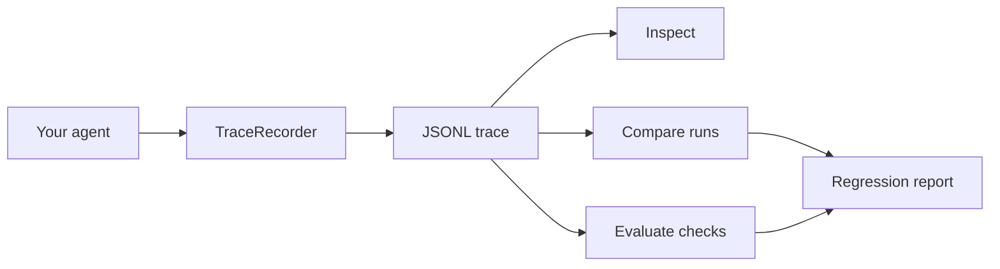

<div align="center">


# Agent Reliability Kit (ARK)

### Record. Inspect. Compare. Gate.

[](https://github.com/Hariharans1971/Agent-Reliability-Kit-ARK-/actions/workflows/tests.yml)
[](https://python.org)
[](LICENSE)
[](CONTRIBUTING.md) [](https://github.com/Hariharans1971/Agent-Reliability-Kit-ARK-/stargazers)

**AI agents are easy to demo. They are harder to trust.**

A local-first Python toolkit for recording AI-agent workflows as readable JSONL traces and enforcing explicit CI contracts: allowed/required/forbidden actions, per-step execution budgets, and behavioral diffs.

**[Try the offline trace viewer ↗](https://portfolio1-tau-sandy.vercel.app/ark-trace-viewer.html)** · [Quick start](#quick-start) · [CI integration](docs/CI_INTEGRATION.md) · [Contribute](CONTRIBUTING.md)

**See a real failure:** the synthetic [duplicate-refund example](docs/CI_INTEGRATION.md#try-the-duplicate-refund-example) shows how a policy can reject a second refund submission.

</div>

---

## Why ARK?

Agent workflows can fail in subtle ways: a tool receives the wrong arguments, a result changes after a prompt update, or token usage grows unexpectedly. ARK gives developers a portable record and repeatable checks without requiring a hosted service or LLM API key.

| Capability | What it does |
|---|---|
| **Record** | Capture tool inputs/outputs, decisions, durations, and token counters |
| **Inspect** | Summarize a trace from the command line |
| **Diff** | Compare runs while ignoring timestamps and generated IDs |
| **Evaluate** | Run deterministic checks locally or in CI |
| **Gate** | Enforce JSON policy contracts for allowed/required/forbidden events, call limits, and total/per-step duration/token budgets |
| **Privacy-first** | Store JSONL locally; optional best-effort key redaction |
| **Offline viewer** | Search local JSONL events and inspect nested payloads in a browser without external libraries |
| **Framework-agnostic** | Instrument ordinary Python functions; keep integrations optional |

## Quick start

**Requirements:** Python 3.10+.

```bash
git clone https://github.com/Hariharans1971/Agent-Reliability-Kit-ARK-.git
cd Agent-Reliability-Kit-ARK-
python -m venv .venv

# Windows PowerShell
.\.venv\Scripts\Activate.ps1

# macOS / Linux
source .venv/bin/activate

python -m pip install -e .
python examples/customer_support_agent.py
ark inspect artifacts/customer-support.jsonl
ark evaluate artifacts/customer-support.jsonl --min-steps 3
ark diff examples/expected-refund-trace.jsonl examples/actual-refund-trace.jsonl --show-paths
ark policy artifacts/customer-support.jsonl --policy policies/customer-support.json
```

To see the failure path, run this separately; it is expected to exit with code `1` because the sample trace contains event names outside the restrictive allowlist:

```bash
ark policy examples/sample-trace.jsonl --policy policies/reject-sample.json
```

## Offline browser viewer

**Try it online:** [Open the Vercel demo](https://portfolio1-tau-sandy.vercel.app/ark-trace-viewer.html).

Open [`examples/trace-viewer.html`](examples/trace-viewer.html) in a browser, choose **Load sample trace**, or select a local JSONL file. The viewer shows summary metrics, lets you search/filter events, and displays the selected event's fields.

It is a single HTML file with no third-party libraries or network calls. The file is read in your browser; the viewer does not upload traces. It is for inspection only, not a policy evaluator or a redaction/security scanner. Use `ark policy` for automated enforcement.

## Real regression example: duplicate refund submission

A baseline trace contains one `refund_submit` event. The changed trace contains two. ARK can compare both runs and enforce a policy limiting refund submissions to one call:

```bash
ark diff examples/expected-refund-trace.jsonl examples/actual-refund-trace.jsonl --show-paths
ark policy examples/expected-refund-trace.jsonl --policy policies/refund-safety.json
ark policy examples/actual-refund-trace.jsonl --policy policies/refund-safety.json
```

The first policy check should pass; the second should fail with exit code `1`. Both traces are synthetic and make no real payment calls. See the full [CI integration guide](docs/CI_INTEGRATION.md).

## 60-second example

```python
from ark import TraceRecorder

trace = TraceRecorder("refund-agent", tags={"environment": "demo"})
trace.record(
    kind="tool",
    name="order_lookup",
    inputs={"order_id": "ORD-1042"},
    outputs={"status": "delivered", "amount": 49.99},
    duration_ms=18,
)
trace.record(
    kind="decision",
    name="refund_eligibility",
    inputs={"days_since_delivery": 3},
    outputs={"eligible": True},
)
trace.save("run.jsonl")
```

Each record becomes one line of JSONL. You can attach a trace to a bug report, diff runs in Git, or connect it to your own evaluation pipeline.

## How it works



ARK does not execute an LLM or transmit trace data by itself. A passing check means only that the configured checks passed; it is not a guarantee of agent correctness.

## Use ARK as a GitHub Action

ARK includes a composite action so a repository can fail CI when a recorded agent run violates a policy:

```yaml
- name: Generate or collect your agent trace
  run: python your_agent_test.py

- name: Enforce agent execution contract
  uses: Hariharans1971/Agent-Reliability-Kit-ARK-@3ed7a4a84f09968431e4657f332e6b7f48125c76
  with:
    trace: artifacts/agent-trace.jsonl
    policy: policies/agent-policy.json
    python-version: "3.12"
```

This example pins a reviewed commit SHA rather than tracking a moving branch. When upgrading, review the change and update the SHA (or use a signed/reviewed release tag). The trace and policy paths are resolved from the consuming repository's workspace. The same pinned revision is exercised by the [consumer-style CI workflow](.github/workflows/consumer-smoke.yml).

## CLI reference

See the full [CLI reference](docs/CLI.md) for usage details.

| Command | Purpose |
|---|---|
| `ark inspect TRACE` | Summarize event count, types, duration, and token totals |
| `ark diff EXPECTED ACTUAL` | Report changed, added, or removed event positions |
| `ark diff EXPECTED ACTUAL --ignore-path inputs.request_id` | Ignore a selected dynamic field; repeat the flag for more paths |
| `ark diff EXPECTED ACTUAL --show-paths` | Show nested added, removed, and changed fields for each changed event |
| `ark evaluate TRACE` | Run baseline checks |
| `ark evaluate TRACE --min-steps 3` | Require at least three events |
| `ark evaluate TRACE --require order_lookup` | Require a named event |
| `ark evaluate TRACE --json` | Emit machine-readable baseline checks |
| `ark evaluate TRACE --junit-xml report.xml` | Write JUnit XML for CI test reporting |
| `ark policy TRACE --policy POLICY.json` | Enforce event allowlists, required/forbidden events, and total/per-event metric budgets |
| `ark policy TRACE --policy POLICY.json --json` | Emit machine-readable policy results |
| `ark policy TRACE --policy POLICY.json --junit-xml report.xml` | Write policy checks as JUnit XML |

**Exit codes:** `0` checks passed, `1` regression/check failed, `2` invalid input or unreadable trace.

## Releases

No versioned GitHub Release has been published yet. The first `v0.1.0` alpha release is staged with curated notes and a validation-gated workflow that runs tests on Python 3.10–3.12, builds the package, verifies a clean installation, creates checksums, and prepares a draft release. Final public/Marketplace publication stays in GitHub's release form.

- [Staged v0.1.0 alpha release notes](docs/releases/v0.1.0.md)
- [Release workflow](.github/workflows/release.yml)
- [Release checklist](docs/RELEASING.md)
- [Run the release workflow in GitHub Actions](https://github.com/Hariharans1971/Agent-Reliability-Kit-ARK-/actions/workflows/release.yml)

## Roadmap

- [x] JSONL trace recorder and reader
- [x] Inspect, diff, evaluate, and policy CLI
- [x] Declarative JSON policies for allowlisted/required/forbidden events, event/call limits, and total/per-step duration/token budgets
- [x] Reusable composite GitHub Action for policy enforcement
- [x] Best-effort recursive key redaction
- [x] Unit tests and GitHub Actions CI, including expected policy rejection
- [ ] Golden-trace fixture packs and comparison presets
- [x] Per-event duration and token budgets with missing-metric failure
- [x] JUnit XML output for policy and evaluation checks
- [ ] Optional LangChain callback adapter
- [ ] Optional OpenAI-compatible API adapter
- [x] Offline single-file HTML viewer for local JSONL traces
- [ ] CLI-exported self-contained report for sharing

Roadmap items are proposals, not completed features. Please open an issue before starting a large contribution.

## Contributing

Bug reports, documentation improvements, synthetic examples, tests, and small integrations are welcome. Start with [CONTRIBUTING.md](CONTRIBUTING.md), check [the roadmap](docs/ROADMAP.md), or open an issue.

For a code change:

```bash
python -m unittest discover -s tests -v
```

### Open contribution opportunities

- [Add a synthetic trace fixture pack (#7)](https://github.com/Hariharans1971/Agent-Reliability-Kit-ARK-/issues/7) — give new contributors reproducible JSONL examples and CI learning cases.
- [Validate ARK from a separate consumer repository (#5)](https://github.com/Hariharans1971/Agent-Reliability-Kit-ARK-/issues/5) — verify how the action behaves from a separate project.

Please comment on an issue before starting larger changes so we can agree on a small, reviewable scope.

## Security and privacy

Trace files may contain prompts, tool arguments, identifiers, or sensitive customer context. Never commit secrets or real production traces. The redaction helper is best-effort and does not guarantee anonymity. See [SECURITY.md](SECURITY.md).

## Documentation

- [Trace format](docs/TRACE_FORMAT.md)
- [Policy contracts](docs/POLICY_CONTRACTS.md)
- [Architecture and limitations](docs/ARCHITECTURE.md)
- [Why ARK? Project positioning and related tools](docs/WHY_ARK.md)
- [Roadmap](docs/ROADMAP.md)
- [Release checklist](docs/RELEASING.md)
- [Contribution guide](CONTRIBUTING.md)
- [Security policy](SECURITY.md)
- [Citation metadata](CITATION.cff)
- [Launch and adoption plan](docs/LAUNCH_PLAN.md)

## Project status

ARK is an early MVP built to invite practical feedback. Please report rough edges and limitations honestly. The best next feature is the one that solves a real user problem.

---

<div align="center">

**Found a bug? Open an issue. Have a feature idea? Use the feature-request template.**

If ARK helps your team catch a real regression, consider [starring the repository](https://github.com/Hariharans1971/Agent-Reliability-Kit-ARK-/stargazers) and sharing a reproducible synthetic example.

Created by [Hariharan S.](https://github.com/Hariharans1971) · Released under the [MIT License](LICENSE)

</div>
